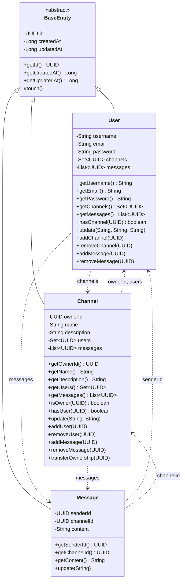
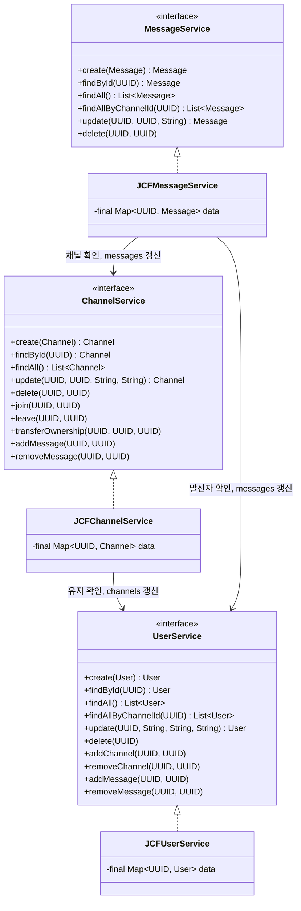
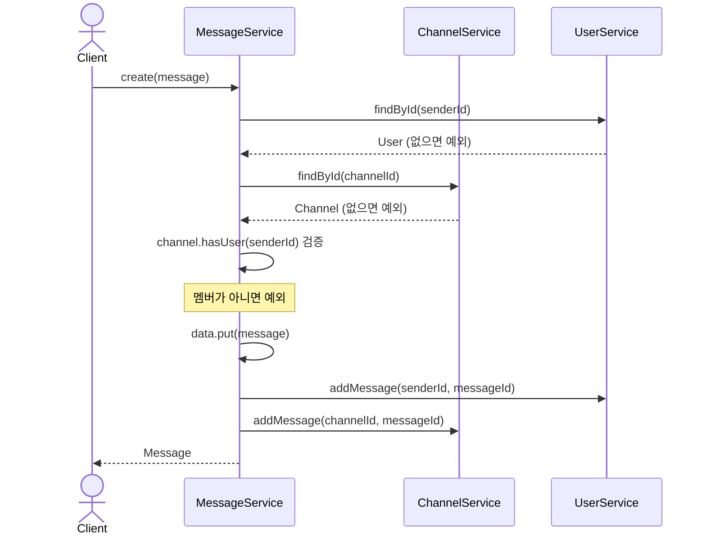
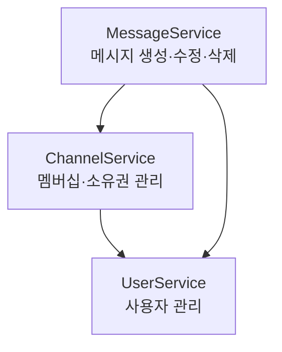

# Discodeit

> Java Collections Framework 기반 채팅 서비스 도메인 모델 & 서비스 구현 (스프린트 미션 1)

 

## 진행 현황

### 기본 요구사항
- [x] 프로젝트 초기화 (Java 17, Gradle, `.idea` 제외)
- [x] 도메인 모델 구현 (`BaseEntity`, `User`, `Channel`, `Message`)
  - [x] 공통 필드: `id`, `createdAt`, `updatedAt`
  - [x] Getter, `update` 메소드
- [x] 서비스 인터페이스 설계 (`UserService`, `ChannelService`, `MessageService`)
- [x] JCF 구현체 구현 (`JCFUserService`, `JCFChannelService`, `JCFMessageService`)
  - [x] `data` 필드 `final` 선언 및 생성자 초기화
- [x] `JavaApplication` 테스트
  - [x] 등록 / 조회 (단건, 다건)
  - [x] 수정 / 수정된 데이터 조회
  - [x] 삭제 / 삭제 확인

### 심화 요구사항
- [x] 서비스 간 의존성 주입 (`User` ← `Channel` ← `Message`)
- [x] `Message` 생성 시 연관 데이터 검증 (발신자, 채널, 채널 멤버)
- [x] 검증 로직 테스트

### 문서
- [x] 클래스 다이어그램
- [x] 시퀀스 다이어그램

### 피드백 반영
- [x] Channel에 List<UUID> messages 필드 추가
- [x] Channel의 receiverId 필드 삭제
- [x] User에 Set<UUID> channels 필드 추가
- [x] User에 List<UUID> messages 필드 추가
- [x] Service 구현 객체의 update 메서드 수정
- [ ] 의존성 순환 문제 해결(진행 중...) (사용자 삭제 시 채널과 메시지가 있으면 예외 발생으로 일단 처리)

 

## 클래스 다이어그램

### Entity

### Service

 

## 시퀀스 다이어그램

### 메시지 생성 (연관 데이터 검증)

 

## 서비스 간 의존 방향

> 화살표는 "~를 사용한다"는 뜻이며, **위에서 아래로만** 흐릅니다. (순환 의존 없음)

 

## 설계 규칙

| 구분 | 규칙 |
|---|---|
| 의존 방향 | 서비스는 **아래 서비스만** 생성자로 주입받는다 (`User` ← `Channel` ← `Message`) |
| 변경 입구 | 입장·퇴장·메시지 생성/삭제는 **서비스 메서드를 통해서만** 한다 (양쪽 목록을 함께 갱신) |
| 검증 순서 | 검증을 모두 끝낸 뒤에 값을 변경한다 |
| 삭제 정책 | 관계가 남아 있으면 삭제를 **거부**한다 |

### 삭제 정책 상세

| 대상 | 삭제 거부 조건 | 삭제 시 정리 |
|---|---|---|
| User | 참여 중인 채널 또는 작성한 메시지가 남아 있음 | 없음 |
| Channel | 메시지가 남아 있음 | 참여 중인 유저의 `channels`에서 채널 제거 |
| Message | 없음 | `User.messages`, `Channel.messages`에서 메시지 제거 |

> 올바른 삭제 순서: **메시지 → 채널 → 사용자**
