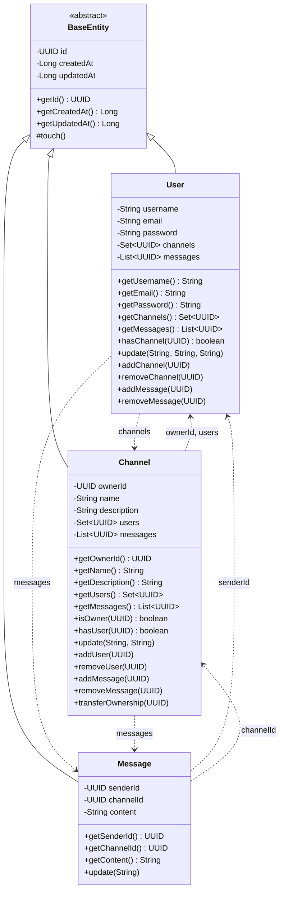
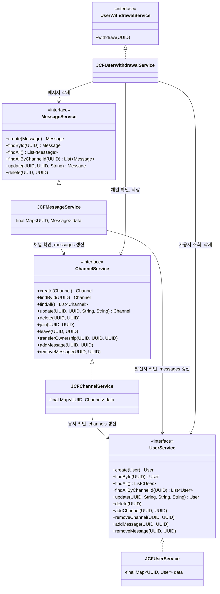
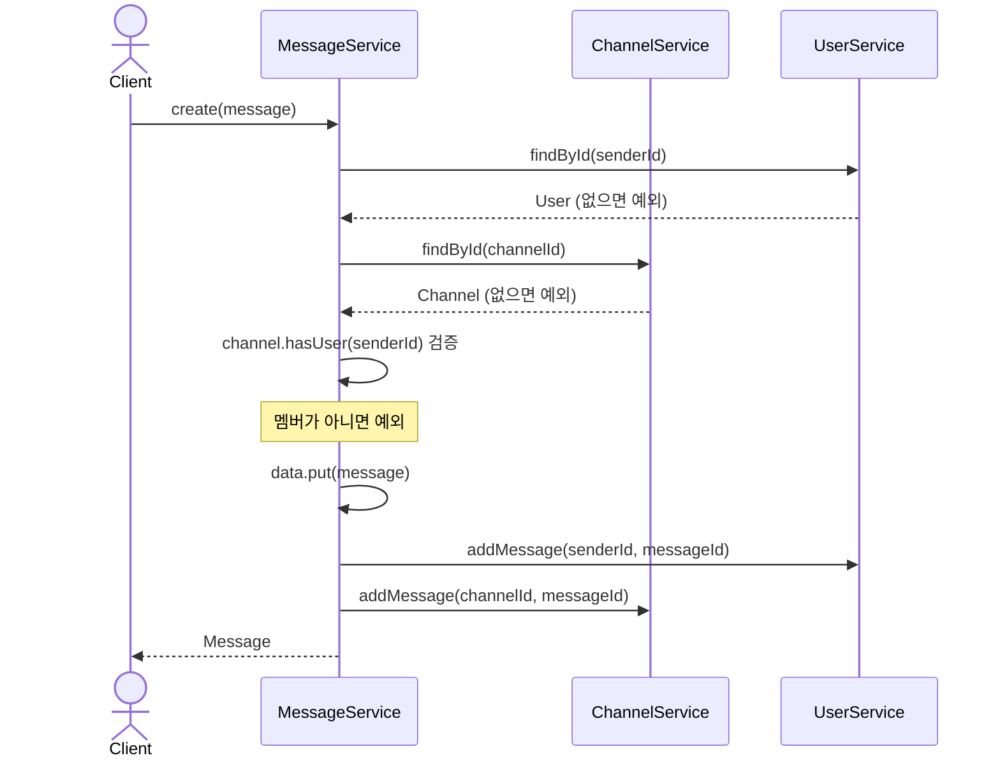
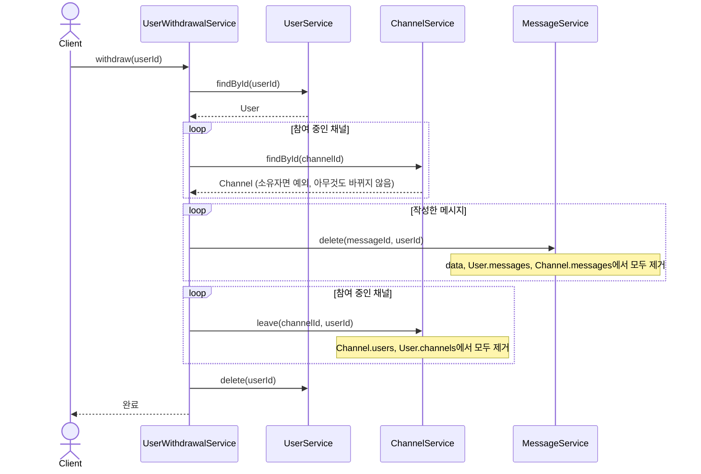
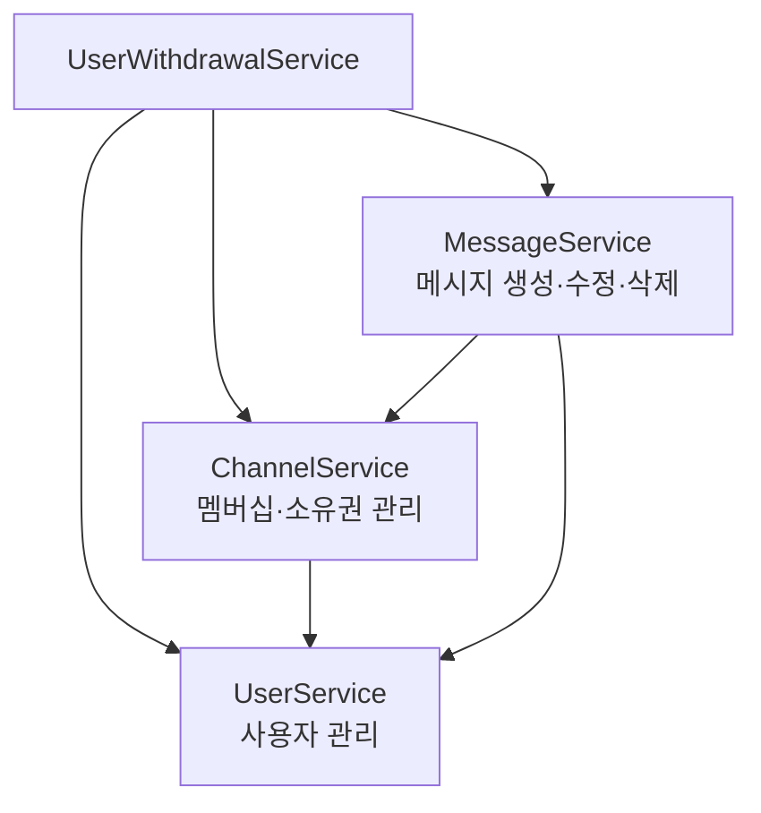
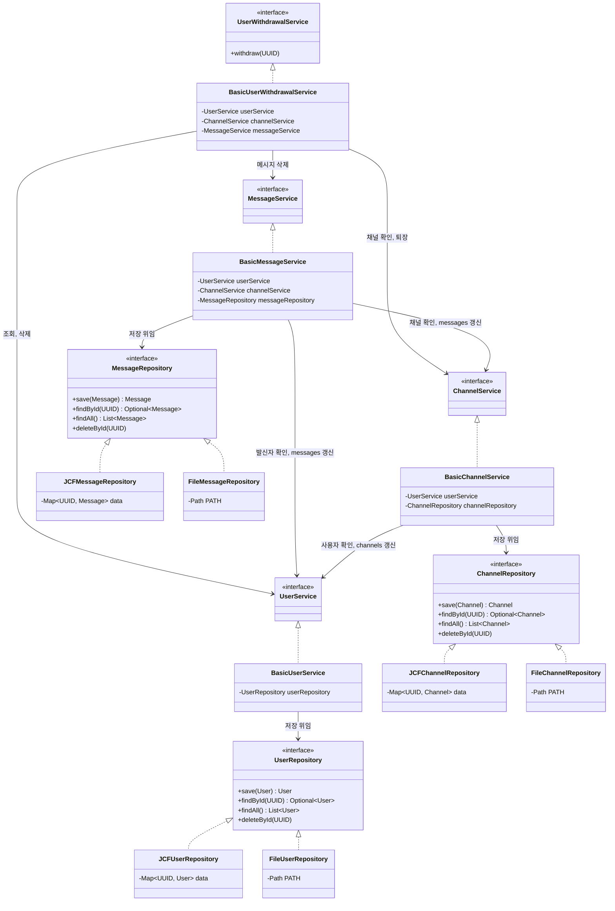

## 진행 현황

### 기본 요구사항
- [x] 프로젝트 초기화 (Java 17, Gradle, `.idea` 제외)
- [x] 도메인 모델 구현 (`BaseEntity`, `User`, `Channel`, `Message`)
  - [x] 공통 필드: `id`, `createdAt`, `updatedAt`
  - [x] Getter, `update` 메소드
- [x] 서비스 인터페이스 설계 (`UserService`, `ChannelService`, `MessageService`)
- [x] JCF 구현체 구현 (`JCFUserService`, `JCFChannelService`, `JCFMessageService`)
  - [x] `data` 필드 `final` 선언 및 생성자 초기화
- [x] `JavaApplication` 테스트
  - [x] 등록 / 조회 (단건, 다건)
  - [x] 수정 / 수정된 데이터 조회
  - [x] 삭제 / 삭제 확인

### 심화 요구사항
- [x] 서비스 간 의존성 주입 (`User` ← `Channel` ← `Message`)
- [x] `Message` 생성 시 연관 데이터 검증 (발신자, 채널, 채널 멤버)
- [x] 검증 로직 테스트

### 문서
- [x] 클래스 다이어그램
- [x] 시퀀스 다이어그램

### 피드백 반영
- [x] Channel에 List<UUID> messages 필드 추가
- [x] Message의 receiverId 필드 삭제
- [x] User에 Set<UUID> channels 필드 추가
- [x] User에 List<UUID> messages 필드 추가
- [x] Service 구현 객체의 update 메서드 수정
- [x] 의존성 순환 문제 해결 (사용자 삭제 시 채널과 메시지가 있으면 예외 발생으로 일단 처리)
- [x] 사용자 탈퇴 처리 (`UserWithdrawalService`)

 

## 클래스 다이어그램

### Entity

### Service

 

## 시퀀스 다이어그램

### 메시지 생성 (연관 데이터 검증)

### 사용자 탈퇴

 

## 서비스 간 의존 방향

> 화살표는 "~를 사용한다"는 뜻이며, **위에서 아래로만** 흐릅니다. (순환 의존 없음)

 

## 설계 규칙

| 구분 | 규칙 |
|---|---|
| 의존 방향 | 서비스는 **아래 서비스만** 생성자로 주입받는다 (`User` ← `Channel` ← `Message`) |
| 변경 입구 | 입장·퇴장·메시지 생성/삭제는 **서비스 메서드를 통해서만** 한다 (양쪽 목록을 함께 갱신) |
| 검증 순서 | 검증을 모두 끝낸 뒤에 값을 변경한다 |
| 삭제 정책 | 관계가 남아 있으면 삭제를 **거부**한다 |
| 탈퇴 정책 | 탈퇴는 UserWithdrawalService를 통해서만 한다 |

### 삭제 정책 상세

| 대상 | 삭제 거부 조건 | 삭제 시 정리 |
|---|---|---|
| User | 참여 중인 채널 또는 작성한 메시지가 남아 있음 | 없음 |
| Channel | 메시지가 남아 있음 | 참여 중인 유저의 `channels`에서 채널 제거 |
| Message | 없음 | `User.messages`, `Channel.messages`에서 메시지 제거 |

### 탈퇴 정책 상세

| 단계 | 처리 |
|---|---|
| 1. 검증 | 소유한 채널이 있으면 거부 (아무것도 바뀌지 않음) |
| 2. 메시지 | 작성한 메시지를 모두 삭제 (`data`, `User.messages`, `Channel.messages`에서 제거) |
| 3. 채널 | 참여 중인 채널에서 모두 퇴장 |
| 4. 사용자 | `UserService.delete` (관계가 비어 있어 기존 삭제 규칙을 통과) |

> 올바른 삭제 순서: **메시지 → 채널 → 사용자**

 

### 기본 요구사항
- [x] File IO를 통한 데이터 영속화
  - [x] 도메인 모델 직렬화 (`Serializable`, `serialVersionUID`)
  - [x] File 구현체 구현 (`FileUserService`, `FileChannelService`, `FileMessageService`)
  - [x] `JavaApplication` 테스트 (File*Service)
- [x] 서비스 구현체 분석
  - [x] JCF*Service / File*Service 공통점·차이점 비교
  - [x] "비즈니스 로직" 코드 식별 (검증 등 저장 로직 제외 로직들) (까다로움)
  - [x] "저장 로직" 코드 식별 (save, findById, findAll, deleteById) (까다로움)
- [x] 레포지토리 설계 (`UserRepository`, `ChannelRepository`, `MessageRepository`)
- [x] JCF 구현체 구현 (`JCFUserRepository`, `JCFChannelRepository`, `JCFMessageRepository`)
  - [x] JCF*Service 저장 로직 참고
- [x] File 구현체 구현 (`FileUserRepository`, `FileChannelRepository`, `FileMessageRepository`)
  - [x] File*Service 저장 로직 참고

### JCF*Service, File*Service 차이점 비교

| 구분 | `JCF*Service | File*Service |
|---|---|---|
| 저장 위치 | 메모리의 Map | 컴퓨터의 data/ 폴더 안 .ser 파일 |
| 지속성 | 휘발성 | 비휘발성 |
| 의존 | 서비스가 구체적인 저장 수단에 직접 의존 | = |

### 심화 요구사항
- [x] 관심사 분리를 통한 레이어 간 의존성 주입
  - [x] Basic 구현체 구현 (`BasicUserService`, `BasicChannelService`, `BasicMessageService`)
  - [x] Repository 인터페이스를 필드로 선언, 생성자로 주입
  - [x] "저장 로직"은 Repository에 위임
- [x] `JavaApplication` 테스트
  - [x] Basic*Service + JCF*Repository
  - [x] Basic*Service + File*Repository
- [x] 이전 코드(JCF*Service, File*Service)와 차이 정리

### 이전 코드(JFC*Service, File*Service)와 현재 코드(Basic*Service, *Repository) 차이 정리

| 원칙 | `JCF*Service` / `File*Service` | `Basic*Service` | `*Repository` | 결과 |
|---|---|---|---|---|
| 단일 책임 원칙 (Single Responsibility Principle) | 비즈니스 규칙과 저장 방식을 함께 담당하여 변경 이유가 둘 | 비즈니스 규칙만 담당 | 저장만 담당 | 개선 |
| 개방-폐쇄 원칙 (Open-Closed Principle) | 저장 방식을 추가하려면 서비스를 새로 만들어 규칙을 복사해야 함 | 저장 방식이 늘어나도 수정하지 않음 | 새 구현체를 추가하는 것으로 확장 | 개선 |
| 리스코프 치환 원칙 (Liskov Substitution Principle) | 같은 서비스 인터페이스를 구현하여 서로 교체 가능 | 같은 서비스 인터페이스를 구현하여 교체 가능 | `JCF*Repository`와 `File*Repository`를 교체 가능, 단 `JCF`는 원본 객체를, `File`은 복사본을 반환하므로 수정 후 `save` 호출이 필수 | 유지 (주의 필요) |
| 인터페이스 분리 원칙 (Interface Segregation Principle) | 서비스 인터페이스에 다른 도메인 기록 갱신 메서드(`addChannel`, `addMessage` 등)가 섞여 있음 | 같은 서비스 인터페이스를 그대로 사용 | `save`, `findById`, `findAll`, `deleteById` 4개로 작고 응집됨 | Repository에서 개선, 서비스는 변화 없음 |
| 의존 역전 원칙 (Dependency Inversion Principle) | `Map`, 파일 같은 구체적인 저장 방식에 직접 의존 | `Repository` 인터페이스에만 의존 | 의존하는 대상 없음 | 개선 |
| 의존성 주입 (Dependency Injection) | 다른 서비스를 생성자로 주입 | 다른 서비스와 Repository를 생성자로 주입 | 주입받는 것 없음 | 범위 확장 |

### 문서
- [x] 클래스 다이어그램

### 피드백 반영
- [x] save() 메서드에서 try-catch문에서 IOException은 e.printStrackTrace로 잡기보다 throw new UncheckedException(e)로 다시 언체크드Exception을 날린다.

 

## 클래스 다이어그램

> 서비스 인터페이스의 메서드 목록은 1차 다이어그램과 같아서 생략

 

## 설계규칙

| 구분 | 규칙 |
|---|---|
| 저장 로직 | 저장 로직은 `Repository` 구현체 안에만 둔다 (`Basic*Service`는 `Map`, 파일을 직접 다루지 않는다) |
| 의존 대상 | 서비스는 다른 서비스 인터페이스와 `Repository` 인터페이스에만 의존한다 (구현체는 생성자로 주입) |
| 변경 후 저장 | 객체를 수정한 뒤에는 반드시 `repository.save(...)`를 호출한다 (`File*Repository`는 복사본을 반환하기 때문) |

### 기본 요구사항
- [x] Spring 프로젝트 초기화 (Gradle-Groovy, Java 17, Spring Boot `4.1.1`, Jar, YAML)
  - [x] Dependency 추가: `Lombok`, `Spring Web`
  - [x] 기존 프로젝트에 병합 후 `DiscodeitApplication` 실행 확인
- [x] Bean 선언 및 테스트
  - [x] `File*Repository`, `Basic*Service` 구현체를 Bean으로 등록
  - [x] `JavaApplication` 테스트 코드를 `DiscodeitApplication`으로 이전
- [ ] Spring 핵심 개념 정리 (IoC Container, DI, Bean)
- [x] Lombok 적용
  - [x] 도메인 모델 getter → `@Getter`
  - [x] `Basic*Service` 생성자 → `@RequiredArgsConstructor`

### 심화 요구사항
- [ ] 시간 필드 타입 `Instant`로 통일
- [ ] 새로운 도메인 추가 (`ReadStatus`, `UserStatus`, `BinaryContent`)
  - [ ] `UserStatus`: 마지막 접속 5분 이내면 온라인으로 판단
  - [ ] `BinaryContent`: 수정 불가 모델 (`updatedAt` 제외)
  - [ ] Repository 인터페이스 및 JCF, File 구현체 구현
- [ ] DTO로 Service 파라미터 그룹화
- [ ] Service 간 주입 대신 Repository 주입으로 순환 참조 방지
- [ ] Service 고도화
  - [ ] `UserService`: 프로필 이미지 등록·교체, 중복 검사, 온라인 상태 포함 조회, 관련 도메인 함께 삭제
  - [ ] `ChannelService`: PUBLIC/PRIVATE 생성 분리, 최근 메시지 시간 포함 조회, `findAllByUserId`, PRIVATE 수정 불가
  - [ ] `MessageService`: 첨부파일 등록, `findAllByChannelId`, 첨부파일 함께 삭제
- [ ] 신규 Service 구현 (`AuthService`, `ReadStatusService`, `UserStatusService`, `BinaryContentService`)

### 문서
- [ ] 클래스 다이어그램
- [ ] 시퀀스 다이어그램

### 피드백 반영
- [ ] 
